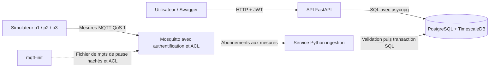

# Jaden Konekté

Projet individuel de Master 2 Informatique — Applications et Services Web,
Université des Antilles. La consigne 2026–2027 est fournie séparément sous le
nom `Projet_2026_Jaden_Konekte.pdf`.

Jaden Konekté permet de suivre des parcelles agricoles, de consulter leurs
mesures, de piloter des vannes simulées et de configurer l’arrosage automatique.
Le tableau de bord donne aussi accès au diagnostic de feuilles de tomate et à
un assistant qui répond à partir de fiches agronomiques.

## Architecture actuelle

| Composant | Rôle |
|---|---|
| [Tableau de bord](frontend/) et [API FastAPI](api/) | Comptes JWT, parcelles, mesures, commandes et mises à jour en temps réel par SSE |
| [Simulateur](simulateur/), Mosquitto et [ingestion](ingestion/README.md) | Le simulateur publie les mesures sur MQTT. L’ingestion les valide et les stocke dans TimescaleDB. L’API publie les ordres de vanne et reçoit les états. |
| [Arrosage](api/app/services/arrosage.py) | Les règles combinent l’humidité du sol, les prévisions Open-Meteo et l’état de la vanne. |
| [Diagnostic CNN](ia/cnn/README.md) | Un service d’inférence ONNX analyse les photos de feuilles. L’API conserve le résultat associé à la parcelle. |
| [Assistant RAG](ia/rag/README.md) | L’API recherche les passages dans pgvector et transmet la réponse d’Ollama et ses citations par SSE. |

Le [code ESP32](esp32/) et le [serveur régional](serveur-central/), dont le
[contrat est dans `contrats/`](contrats/reseau-regional.openapi.yaml), sont
disponibles séparément de la démonstration Compose.

## Démarrage et démonstration

Prévoir Docker avec Compose v2, OpenSSL et un accès Internet pour télécharger
les images et les modèles. La recommandation d’irrigation a besoin d’accéder à
Open-Meteo depuis l’API. Le dépôt fournit déjà le modèle CNN exporté.

Sur une installation neuve, créer les deux fichiers locaux ignorés par Git.
Le mot de passe PostgreSQL est hexadécimal pour être utilisable directement
dans l’URL de connexion. Sur une installation existante, conserver le secret
JWT et utiliser le mot de passe du volume PostgreSQL déjà initialisé.

```sh
# Depuis la racine, uniquement quand les fichiers sont absents
if [ ! -f infra/.env ]; then
    (umask 077 && printf 'POSTGRES_PASSWORD=%s\n' "$(openssl rand -hex 24)" > infra/.env)
fi
if [ ! -f api/.env ]; then
    (umask 077 && printf 'JWT_SECRET=%s\n' "$(openssl rand -hex 32)" > api/.env)
fi
cd infra
docker compose up -d --build
docker compose ps -a
docker compose logs ollama-init
```

Les conteneurs SQL appliquent le schéma sur un volume neuf et exécutent une
migration idempotente pour le RAG sur un volume existant. Le premier démarrage
télécharge les deux modèles Ollama. L’assistant devient disponible après la fin
de `ollama-init` et indexe les fiches lors de sa première question. Les ports
publiés sont accessibles sur la machine locale.

1. Ouvrir [le tableau de bord](http://127.0.0.1:8000/dashboard), créer un compte et se connecter.
2. Depuis la racine, lancer `sh infra/demarrer_simulation.sh --code CODE_EXPLOITATION`
   avec le code saisi à l’inscription. Le script prépare les trois parcelles et
   une vanne par parcelle, puis démarre le simulateur MQTT.
3. Actualiser le tableau de bord, choisir p1, p2 ou p3, et tester le graphique
   24 h/7 jours ainsi que l’ouverture et la fermeture de la vanne.
4. Saisir les coordonnées de la parcelle et enregistrer une règle active.
   Elle est évaluée chaque minute. Un déclenchement demande une mesure récente
   et valide, un sol sous le seuil, moins de 2 mm de pluie prévue sur six heures,
   une vanne fermée et le respect du délai minimal. La commande et le
   déclenchement sont enregistrés dans `commande` et `historique`. En cas
   d’indisponibilité de la météo, la règle attend le cycle suivant.
5. Charger un JPEG ou un PNG de feuille de tomate de 5 Mio maximum et vérifier
   que la classe et son score s’affichent.
6. Poser la question « Comment arroser les tomates ? » dans l’assistant et
   vérifier l’apparition de la réponse puis des citations.

### Points d’accès

| Adresse | Usage |
|---|---|
| [127.0.0.1:8000/dashboard](http://127.0.0.1:8000/dashboard) | Tableau de bord |
| [127.0.0.1:8000/docs](http://127.0.0.1:8000/docs) | Swagger. Après connexion, coller la valeur `access_token` dans **Authorize**. |
| [127.0.0.1:8000/api/v1/sante/database](http://127.0.0.1:8000/api/v1/sante/database) | Vérification de la connexion à PostgreSQL |
| [127.0.0.1:8001/health](http://127.0.0.1:8001/health) | Vérification du service d’inférence |

Depuis `infra/`, consulter les journaux si un écran reste vide ou si un service
est indisponible. Pour arrêter les conteneurs et conserver leurs volumes, utiliser
`docker compose --profile simu stop`.

```sh
docker compose --profile simu ps -a
docker compose --profile simu logs --tail 50 api ingestion simulateur inference-cnn ollama-init
```

### Tests locaux

Depuis la racine, avec Python 3.12 comme dans les images API et ingestion.
Les suites s’exécutent chacune depuis le répertoire du service, car les deux
services utilisent un package nommé `app`.

```sh
python3 -m venv .venv
. .venv/bin/activate
python -m pip install -r api/requirements-dev.txt -r ingestion/requirements.txt
(cd api && python -B -m unittest discover -s tests -v)
(cd ingestion && python -B -m unittest discover -s tests -v)
```

Le [contrat OpenAPI 3.1](openapi.yaml) décrit les routes HTTP et SSE. Le
[guide RAG](ia/rag/README.md) détaille l’évaluation des réponses et le
[guide ingestion](ingestion/README.md) décrit le test MQTT avec TimescaleDB.

### État de la validation

L’audit local a validé 42 tests API, 20 tests d’ingestion, la configuration
Compose, la syntaxe JavaScript et l’inférence ONNX sur une image synthétique.
Le rapport provisoire, fourni séparément sous le nom
`Rapport_Jaden_Konekte_provisoire.pdf`, reprend ces résultats. L’exactitude sur
PlantVillage et les réponses de l’assistant aux questions de référence restent
à évaluer. Le démarrage de tous les conteneurs et le parcours de démonstration
restent à vérifier de bout en bout.

## Archive du bilan technique de la semaine 1

Le bilan ci-dessous décrit l’état du projet au 16 novembre 2026. Pour le
démarrage et les fonctionnalités actuelles, suivre les sections précédentes.

**Bilan au 16 novembre 2026 : le jalon « mesures visibles en base » est atteint.**
L'utilisateur a exécuté avec succès la chaîne simulateur → MQTT → ingestion →
TimescaleDB. Le contrat OpenAPI, l'API, les permissions et les tests ont été
complétés autour du kit existant. L'authentification JWT déjà développée a été
conservée.

Deux vérifications complémentaires restent à confirmer pour clôturer toute la
validation : la lecture des mesures et agrégats réels dans Swagger, et le démarrage
de l'API elle-même dans Docker. La suppression réelle d'une parcelle reste également
à tester ; ses permissions et son refus des suppressions avec données liées sont
couverts par les tests automatisés.

## 1. Ce qui existait et ce qui a changé

Le dossier contenait déjà le kit pédagogique : infrastructure PostgreSQL/Mosquitto,
schéma SQL, simulateur, exemple ESP32, scripts CNN, corpus RAG et serveur régional.
Une API locale avec inscription, connexion JWT et liste des parcelles avait déjà
été développée. Ces éléments ont servi de base au travail ; le projet n'a pas été
recréé et aucun ORM n'a été introduit.

| Domaine | État de départ observé | État après les travaux de semaine 1 |
|---|---|---|
| Authentification | Inscription, connexion, Argon2 et JWT présents | Logique conservée ; validation, documentation et tests complétés |
| Parcelles | Liste protégée par appartenance à l'exploitation | Liste, création, détail, modification partielle et suppression protégées |
| Mesures HTTP | Routes prévues dans le contrat | Lecture paginée et agrégats par heure ou jour implémentés |
| Erreurs | Réponses HTTP FastAPI usuelles | Format Problem Details centralisé, y compris 422, 500 et 503 |
| Contrat OpenAPI | Description partielle des routes | Routes actuelles et schémas complétés, comparaison automatisée avec FastAPI |
| API Docker | Dockerfile vide, service absent de Compose | Image définie et service API ajouté à Compose ; exécution encore à confirmer |
| Ingestion | Aucun service reliant MQTT à PostgreSQL | Service autonome avec validation, stockage, dédoublonnage et reprise |
| Broker | Connexions anonymes autorisées | Authentification, mots de passe générés et droits MQTT par compte |
| Simulation | Code d'exploitation fixé à `expl-1` | Lecture du code réel de l'exploitation et prise en charge des secrets par fichier |
| Vérification | Tests manuels Swagger rapportés | 57 tests unitaires et un scénario réel MQTT → TimescaleDB validé |

Le schéma SQL fourni n'a pas été modifié : aucune migration n'a été nécessaire.
Le fichier `api/.env` et l'environnement `~/nsz_env` ont été préservés. Les scripts
lancés explicitement par l'utilisateur ont ajouté les parcelles de simulation
manquantes, des capteurs et des mesures ; aucune suppression de données n'a été
réalisée pour ces vérifications.

## 2. Architecture réellement implémentée



Le schéma montre le chemin des mesures. Le simulateur sait aussi recevoir les
commandes de vanne et publier son état. L'API HTTP ne pilote pas encore la vanne :
ce parcours sera développé en semaine 2.

| Service Compose | Fonction | Démarrage |
|---|---|---|
| `db` | PostgreSQL 16, TimescaleDB et pgvector | Par défaut ; contrôle de santé PostgreSQL |
| `mqtt-init` | Préparation des comptes, secrets et ACL MQTT | Par défaut ; se termine avec le code 0 |
| `mqtt` | Broker MQTT 1883 et WebSocket 9001 | Après réussite de `mqtt-init` ; contrôle de santé authentifié |
| `ingestion` | Réception et stockage des mesures | Après disponibilité de PostgreSQL et MQTT ; redémarrage automatique |
| `api` | API REST et Swagger, port 8000 | Après disponibilité de PostgreSQL |
| `simulateur` | Quatre grandeurs pour p1/p2/p3 | Profil optionnel `simu` |
| `verification` | Test réel de la chaîne et de certaines restrictions MQTT | Profil `test`, exécution explicite |

L'API peut rester lancée localement dans `nsz_env` pendant que PostgreSQL, MQTT,
l'ingestion et le simulateur tournent dans Docker. Les images Python de l'API,
de l'ingestion et du simulateur utilisent Python 3.12 ; les tests locaux ont été
exécutés sous Python 3.9.6 dans l'environnement existant.

### Choix d'architecture retenus et justifications

| Choix | Justification pour ce projet | Compromis ou limite |
|---|---|---|
| API HTTP et ingestion dans deux processus distincts | Le cycle MQTT et ses reconnexions n'occupent pas le processus servant les requêtes HTTP ; chaque service se redémarre séparément | Deux services Python à configurer et à surveiller |
| Routeurs et modèles Pydantic dans l'API | Séparer les endpoints, la validation et la sécurité facilite la lecture et le contrôle du contrat | Les modèles et `openapi.yaml` doivent rester synchronisés |
| psycopg et SQL explicite conservés | Réutiliser le code existant, rendre visibles les jointures d'accès et employer directement TimescaleDB | Les requêtes et les transactions restent à maintenir manuellement |
| Routes synchrones `def` pour les accès psycopg bloquants | Conserver le pilote synchrone existant et le mode d'exécution prévu par FastAPI pour ces routes | Pas de pool de connexions ; une connexion est ouverte par opération |
| PostgreSQL commun aux données métier et aux mesures | Préserver les relations utilisateur–exploitation–parcelle–capteur et leurs contraintes | L'API et l'ingestion dépendent de la disponibilité de cette base |
| Hypertable TimescaleDB existante | Stocker les mesures horodatées et utiliser `time_bucket` pour leurs agrégats | Agrégats calculés à la demande ; aucune agrégation continue configurée |
| JWT pour l'identité, rôle relu en base | Conserver l'authentification qui fonctionne ; appliquer le rôle actuel dans chaque exploitation | Une requête d'autorisation est nécessaire ; pas de mécanisme de révocation individuel des JWT |
| Autorisations par exploitation | Un utilisateur peut avoir des rôles différents selon son exploitation ; même `admin` reste limité à ses appartenances | Il n'existe pas de superadministrateur global dans ce bloc |
| Conservation des valeurs aberrantes avec un indicateur | Permettre la maintenance des capteurs sans perdre la mesure reçue ; les agrégats filtrent ces valeurs | Les futurs graphiques et règles doivent aussi respecter `valide=false` |
| Dédoublonnage par `(capteur, ts)` | Utiliser la clé primaire existante pour supporter les retransmissions QoS 1 | Une nouvelle valeur au même instant ne remplace pas la première |
| Déclaration des capteurs sur les parcelles connues | Réduire la configuration initiale des quatre grandeurs du kit, sans permettre la création d'exploitations par MQTT | Un seul capteur logique par parcelle/type/grandeur ; les configurations ambiguës sont rejetées |
| Verrous sur parcelle et appartenance | Garder cohérents le contrôle du rôle, la création des capteurs et les modifications concurrentes | Les opérations sur une même parcelle sont sérialisées ; pas de test de charge réalisé |
| Suppression limitée aux parcelles sans données liées | Empêcher une suppression en cascade involontaire de mesures, équipements et règles | Une parcelle utilisée nécessite une politique d'archivage à concevoir plus tard |
| Comptes MQTT par service et ACL | Séparer les droits de lecture, de publication des mesures et de commande ; limiter le simulateur à son exploitation | Les comptes ne sont pas encore individualisés pour chaque capteur physique |
| Volumes pour les données et secrets MQTT | Conserver les données et mots de passe lors de la recréation des conteneurs, sans ajouter les secrets au dépôt | Ce n'est pas un coffre-fort de production ni une sauvegarde externe |
| `unittest`, HTTPX et PyYAML pour les tests | Utiliser le moteur de test fourni avec Python, tester les routes HTTP et lire le contrat YAML | Les tests simulés ne suffisent pas à prouver le fonctionnement réel de PostgreSQL et MQTT |

La configuration actuelle n'impose aucun fournisseur cloud ni service d'inférence
payant pour la semaine 1 : elle s'exécute sur la machine locale avec Docker.
Aucun coût d'hébergement, de consommation électrique ou de montée en charge n'a
été chiffré. Les futurs coûts d'API LLM éventuels ne sont pas inclus dans ce bilan.

## 3. Inventaire des fichiers ajoutés ou adaptés

Les liens permettent de retrouver chaque composant. Cet inventaire décrit les
travaux de la session par rapport à l'état initial observé, et non un historique
Git : le dossier n'était pas reconnu comme dépôt Git lors de l'inspection.

### API et contrat

| Fichier | Modification et rôle |
|---|---|
| [openapi.yaml](openapi.yaml) | Contrat des routes actuelles, `operationId`, entrées, sorties, permissions Bearer et erreurs |
| [api/app/main.py](api/app/main.py) | Assemblage unique des routeurs, installation des erreurs et routes de santé typées |
| [api/app/routers/parcelles.py](api/app/routers/parcelles.py) | CRUD, vérification des accès, pagination et agrégats ; remplace la liste auparavant dans `main.py` |
| [api/app/schemas/parcelles.py](api/app/schemas/parcelles.py) | Modèles de création, PATCH, parcelle publique, mesure et agrégat ; cohérence des schémas numériques JSON |
| [api/app/errors.py](api/app/errors.py) | Réponses Problem Details communes ; 503 pour les erreurs de connexion, 500 sans détail technique exposé |
| [api/app/schemas/systeme.py](api/app/schemas/systeme.py) | Modèles de santé et d'erreur |
| [api/app/routers/auth.py](api/app/routers/auth.py) | Authentification conservée ; documentation des réponses et identifiants d'opération alignés |
| [api/app/schemas/auth.py](api/app/schemas/auth.py) | Validation renforcée, champs inconnus refusés et mots de passe marqués `writeOnly` dans le contrat |
| [api/app/security/dependencies.py](api/app/security/dependencies.py) | Protection JWT conservée ; nom du mécanisme Bearer aligné sur le contrat |
| [api/app/database.py](api/app/database.py) | Gestionnaire transactionnel conservé ; délai maximal de connexion ajouté, 5 secondes |
| [api/requirements.txt](api/requirements.txt) | Dépendances de l'API, dont déclaration explicite de `email-validator` |
| [api/requirements-dev.txt](api/requirements-dev.txt) | HTTPX pour les tests HTTP et PyYAML pour le contrat ; pytest non nécessaire |
| [api/Dockerfile](api/Dockerfile), [api/.dockerignore](api/.dockerignore) | Image API, utilisateur non root, exclusion du `.env` et des fichiers inutiles au build |

Le module [api/app/security/jwt.py](api/app/security/jwt.py) de hachage et de signature
n'a pas été réécrit. L'avertissement de duplication d'opération n'est plus reproduit :
une seule route de liste est déclarée et chaque routeur est enregistré une seule fois.
La cause historique exacte de l'avertissement n'a pas été prouvée.

### Ingestion, simulation et infrastructure

| Fichier | Modification et rôle |
|---|---|
| [ingestion/app/validation.py](ingestion/app/validation.py) | Analyse des topics, JSON, unités, identifiants, dates et nombres finis |
| [ingestion/app/stockage.py](ingestion/app/stockage.py) | Recherche de parcelle, déclaration des capteurs, contrôle des bornes et insertion idempotente |
| [ingestion/app/main.py](ingestion/app/main.py) | Client Paho, abonnements, acquittements et gestion des interruptions |
| [ingestion/app/preparer_simulation.py](ingestion/app/preparer_simulation.py) | Préparation de p1/p2/p3 dans une exploitation existante, sans écraser les parcelles |
| [ingestion/app/verifier_chaine.py](ingestion/app/verifier_chaine.py) | Scénario réel : refus anonyme, ACL, mesure valide, doublon et valeur aberrante |
| [ingestion/requirements.txt](ingestion/requirements.txt), [ingestion/Dockerfile](ingestion/Dockerfile), [ingestion/.dockerignore](ingestion/.dockerignore) | Service Python avec Paho et psycopg, image et contexte de build séparés |
| [infra/compose.yaml](infra/compose.yaml) | Services API, ingestion, initialisation et vérification ; dépendances, volumes et profils |
| [infra/mosquitto/mosquitto.conf](infra/mosquitto/mosquitto.conf) | Désactivation de l'anonymat et activation des fichiers de comptes et d'ACL |
| [infra/mosquitto/initialiser.sh](infra/mosquitto/initialiser.sh) | Génération persistante des secrets, hachage des mots de passe et ACL adaptées à l'exploitation |
| [infra/mosquitto/verifier.sh](infra/mosquitto/verifier.sh) | Contrôle de santé par connexion MQTT authentifiée |
| [infra/demarrer_simulation.sh](infra/demarrer_simulation.sh) | Préparation, lecture du vrai code d'exploitation et démarrage des services concernés |
| [simulateur/simulateur_capteurs.py](simulateur/simulateur_capteurs.py) | Lecture des identifiants MQTT et du code d'exploitation depuis des fichiers ; fonctionnement initial conservé |
| [ingestion/README.md](ingestion/README.md) | Détails du protocole, des bornes, de la reprise et des commandes d'exploitation |

[infra/sql/schema.sql](infra/sql/schema.sql) et les fichiers CNN, RAG, ESP32 et réseau
régional restent ceux déjà présents. Les avoir dans le dossier ne signifie pas que
les fonctionnalités correspondantes sont intégrées à la plateforme.

### Tests

| Fichier | Périmètre |
|---|---|
| [api/tests/test_auth.py](api/tests/test_auth.py) | Hachage, inscription, doublon, connexion et JWT invalides ou expirés |
| [api/tests/test_parcelles.py](api/tests/test_parcelles.py) | Lecture, appartenance, pagination, paramètres et agrégats |
| [api/tests/test_creation_parcelle.py](api/tests/test_creation_parcelle.py) | Création, rôles, validation et conflits de code |
| [api/tests/test_modification_parcelle.py](api/tests/test_modification_parcelle.py) | PATCH partiel, champs conservés, nullabilité et permissions |
| [api/tests/test_suppression_parcelle.py](api/tests/test_suppression_parcelle.py) | Suppression sans corps, accès et conservation des données liées |
| [api/tests/test_contrat_et_erreurs.py](api/tests/test_contrat_et_erreurs.py) | Comparaison du contrat et erreurs normalisées sans détail confidentiel |
| [ingestion/tests/test_validation.py](ingestion/tests/test_validation.py) | Messages valides et invalides, dates, topics et unités |
| [ingestion/tests/test_stockage.py](ingestion/tests/test_stockage.py) | Déclaration, doublons, bornes, refus et ordre stockage/acquittement |
| [ingestion/tests/test_preparation.py](ingestion/tests/test_preparation.py) | Préparation sans écrasement et refus des exploitations inconnues |

## 4. API disponible et règles d'accès

Swagger : `http://127.0.0.1:8000/docs`.
Spécification générée : `http://127.0.0.1:8000/openapi.json`.
Le fichier `openapi.yaml` reste un contrat distinct ; il n'est pas automatiquement
remplacé par la spécification générée.

| Méthode | Route | Fonction et résultat principal |
|---|---|---|
| GET | `/api/v1/sante` | API active, 200 |
| GET | `/api/v1/sante/database` | Connexion SQL, 200 ou 503 |
| POST | `/api/v1/auth/inscription` | Utilisateur, exploitation et appartenance créés dans une transaction, 201 |
| POST | `/api/v1/auth/connexion` | Vérification du mot de passe et émission du JWT, 200 |
| GET | `/api/v1/parcelles` | Parcelles des exploitations accessibles, 200 |
| POST | `/api/v1/parcelles` | Création autorisée, 201 et en-tête `Location` |
| GET | `/api/v1/parcelles/{id}` | Détail accessible, 200 |
| PATCH | `/api/v1/parcelles/{id}` | Modification partielle autorisée, 200 |
| DELETE | `/api/v1/parcelles/{id}` | Suppression sans données liées, 204 sans corps |
| GET | `/api/v1/parcelles/{id}/mesures` | Historique brut paginé, 200 |
| GET | `/api/v1/parcelles/{id}/mesures/agregats` | Agrégats des valeurs valides, 200 |

Les routes de santé et d'authentification sont publiques ; toutes les routes de
parcelles et mesures exigent un JWT Bearer. Les revendications `sub`, `iat` et
`exp` sont vérifiées. L'algorithme par défaut est HS256 et la durée par défaut est
30 minutes, selon la configuration existante.

| Opération dans une exploitation dont l'utilisateur est membre | exploitant | technicien | admin |
|---|---|---|---|
| Lire parcelles, mesures et agrégats | Oui | Oui | Oui |
| Créer, modifier et supprimer une parcelle | Oui | Non | Oui |

Une ressource absente et une ressource hors des exploitations accessibles renvoient
la même erreur 404. Un membre dont le rôle ne permet pas l'écriture reçoit 403.
Le client reçoit 401 si le jeton est absent, invalide ou expiré.

Les listes utilisent `limit` et `offset`. Pour les parcelles : limite par défaut 20,
maximum 100. Pour les mesures : défaut 100, maximum 1000 ; tri par date décroissante,
puis capteur. Les agrégats utilisent `intervalle=heure|jour` et `jours=1..7` : la
fenêtre est glissante, les regroupements sont en UTC et les dates futures sont
exclues. Les mesures brutes exposent aussi `valide=false` pour la maintenance.

Exemple de création dans l'exploitation 1 :

```json
{"exploitation": 1, "code": "p1", "nom": "Parcelle de tomates", "culture": "tomate", "surface_m2": 120, "seuil_sec": 25}
```

Le code accepte lettres ASCII, chiffres, tirets et underscores, sur 30 caractères
au plus. La surface est facultative, positive et limitée à deux décimales. Le seuil
est compris entre 0 et 100, avec deux décimales au plus et une valeur par défaut de
25. Les champs inconnus sont refusés.

PATCH accepte `nom`, `culture`, `surface_m2` et `seuil_sec`. Les champs omis restent
inchangés ; seule la surface accepte explicitement `null`. Le code MQTT et
l'exploitation restent fixes. DELETE renvoie 409 si la parcelle possède des
capteurs, équipements, règles ou diagnostics, afin de protéger leurs données liées.

Les erreurs utilisent `application/problem+json` et les champs `type`, `title`,
`status`, `detail`, `instance`. Les doublons métier renvoient 409, les données
invalides 422, une connexion SQL indisponible 503 et une erreur interne 500 sans
trace technique ni secret dans la réponse.

## 5. Modèle de données et parcours d'une mesure

Le schéma fourni comprend treize tables. La semaine 1 utilise surtout :

```text
utilisateur ← membre → exploitation → parcelle → capteur → mesure
```

`membre` porte un rôle par couple utilisateur/exploitation. Le couple
`(exploitation, code)` identifie une parcelle de manière unique. `mesure` est une
hypertable TimescaleDB avec clé primaire `(capteur, ts)`. Les tables d'équipements,
commandes, règles, diagnostics, alertes, historique et passages RAG préparent les
étapes suivantes ; leur présence ne prouve pas que les services correspondants
fonctionnent déjà.

Le parcours implémenté est le suivant :

1. Le simulateur publie, par exemple, sur `jaden/string/p1/sol/humidite` en QoS 1.
2. Mosquitto authentifie le compte et applique ses ACL.
3. L'ingestion vérifie le topic, le JSON, l'unité, l'identifiant capteur et l'heure.
4. Elle retrouve une parcelle existante à partir des codes d'exploitation et de parcelle.
5. Elle retrouve ou déclare son capteur logique, sous verrou de la parcelle.
6. Elle compare la valeur aux bornes physiques, puis insère dans une transaction.
7. Un doublon est ignoré par `ON CONFLICT (capteur, ts) DO NOTHING`.
8. L'acquittement MQTT intervient après le commit ; l'API peut ensuite lire la mesure.

Un message d'exemple :

```json
{"valeur": 31.2, "unite": "%", "ts": "2026-11-16T10:00:00Z", "capteur": "p1-sol"}
```

| Topic après `jaden/<exploitation>/<parcelle>/` | Unité | Bornes par défaut incluses |
|---|---|---|
| `sol/humidite` | % | 0 à 100 |
| `air/temperature` | °C | -20 à 65 |
| `air/luminosite` | lx | 0 à 150000 |
| `pluvio/intensite` | mm/h | 0 à 500 |

Les bornes sont pédagogiques et peuvent être adaptées avec `min_valide` et
`max_valide` dans `capteur`. Une valeur hors bornes est conservée avec `valide=false`.
Un JSON mal formé, une unité incohérente, un nombre NaN/infini, une heure sans fuseau,
un capteur inactif ou une parcelle inconnue provoquent un rejet journalisé. Les
horodatages ISO 8601 avec fuseau et les timestamps Unix en secondes sont acceptés,
puis normalisés en UTC. La taille maximale d'un message traité est de 4 Ko.

Une humidité de 0 % n'est pas considérée comme une panne à elle seule ; -1 et 999
sont hors bornes. La détection statistique d'anomalies n'est pas implémentée.
Les messages de statut et d'état de vanne ne sont pas enregistrés par ce service.

En cas d'erreur SQL, le message n'est pas acquitté et le processus s'arrête ; Docker
le redémarre. La session MQTT persistante permet une redistribution des messages
QoS 1 en attente. Cette reprise dépend des volumes et limites de file du broker ;
elle ne garantit pas une conservation illimitée ou une absence de perte après
suppression des volumes. Le service utilise un identifiant client fixe et est
prévu ici en une seule instance.

## 6. Sécurité MQTT et configuration

| Compte | Droits configurés |
|---|---|
| `ingestion` | Lire les quatre grandeurs de mesure et la version du broker pour le contrôle de santé |
| `simulateur` | Publier mesures, états et statuts de l'exploitation sélectionnée ; lire ses commandes de vanne |
| `api` | Publier des commandes de vanne et lire états/statuts ; compte réservé au futur pilotage HTTP et aux outils manuels |

Les connexions anonymes sont désactivées sur MQTT et WebSocket. Les mots de passe
sont générés aléatoirement et conservés dans des volumes dédiés. Le broker utilise
un fichier de mots de passe hachés et un fichier d'ACL ; les clients lisent leur
secret depuis un fichier monté en lecture seule. Les recréations de conteneurs
réutilisent ces secrets. `mqtt-init` terminé avec `Exited (0)` est le résultat attendu.

Le fichier `api/.env` reste réservé à la configuration existante de l'API :
`DATABASE_URL`, `JWT_SECRET`, `JWT_ALGORITHM`, `JWT_EXPIRATION_MINUTES`. Il n'est pas
copié dans l'image. Dans Compose, l'URL de base de l'API et de l'ingestion utilise
le nom interne `db` ; une API locale utilise son URL configurée dans `.env`.

Les identifiants PostgreSQL du kit restent des identifiants de développement.
Le transport MQTT n'est pas chiffré par TLS et les ports sont publiés sur la machine.
Les comptes, la rotation des secrets, les sauvegardes et l'exposition réseau doivent
être revus pour un déploiement hors de cet environnement de développement.

## 7. Résultats vérifiés et preuves de semaine 1

### Tests automatisés

**57 tests ont passé sous Python 3.9.6 : 37 pour l'API et 20 pour l'ingestion.**
Les accès SQL et MQTT y sont simulés ; ils ne prouvent pas à eux seuls l'exécution
réelle des contraintes, verrous ou reconnexions après panne.

Le contrôle de contrat compare routes, méthodes, identifiants d'opération, sécurité,
codes HTTP, paramètres, types de contenu et schémas. Il normalise certaines formes
JSON Schema équivalentes et ignore les métadonnées ; ce n'est pas une preuve de
conformité exhaustive pour toutes les valeurs possibles.

### Vérifications réelles rapportées par l'utilisateur

Le 16 novembre 2026, le démarrage a confirmé PostgreSQL et Mosquitto sains,
`mqtt-init` terminé avec 0, et l'ingestion ainsi que le simulateur démarrés.
L'exploitation sélectionnée a l'identifiant `1` et le code réel `string` ; les
messages de simulation sont donc rattachés à ce code, sans supposer `expl-1`.

Le premier essai de vérification a détecté le broker encore anonyme. Après
exécution du script de préparation, le second essai a produit :

```text
Parcelle de test créée : id=6, code=test-ingestion-1ce6b355 (conservée après le test)
Connexion anonyme refusée : OK
Publication hors exploitation bloquée par les ACL : OK
Chaîne MQTT → TimescaleDB : OK ; 1 valide, 1 aberrante, doublon ignoré
```

Ce résultat confirme une insertion réelle dans TimescaleDB et l'effet des ACL
sur le scénario testé. La connexion JWT, la création et la modification de parcelle
avaient aussi été validées par l'utilisateur dans Swagger. Les parcelles de test
restent enregistrées ; chaque nouvelle exécution crée une nouvelle parcelle.

### État de clôture

| Vérification | État |
|---|---|
| Contrat OpenAPI et tests de comparaison | Validés automatiquement pour le périmètre décrit |
| Tables examinées et hypertable `mesure` | Vérifiées dans PostgreSQL par l'utilisateur |
| Connexion JWT, création et modification de parcelle | Validées dans Swagger par l'utilisateur |
| Démarrage des services d'ingestion et de simulation | Validé dans Docker par l'utilisateur |
| Refus anonyme, restriction du simulateur, stockage et doublon | Validés par le scénario réel |
| Lecture HTTP des mesures réellement ingérées | À confirmer dans Swagger |
| Agrégats sur les mesures réellement ingérées | À confirmer dans Swagger ; requête et filtrage testés avec accès SQL simulé |
| Suppression réelle d'une parcelle de test | À confirmer ; permissions et données liées testées avec accès SQL simulé |
| Démarrage de l'API dans Docker | Configuration validée, exécution à confirmer ; l'API actuelle tourne localement |

## 8. Commandes pour reprendre le projet

### API locale avec l'environnement existant

Depuis la racine du projet :

```bash
source ~/nsz_env/bin/activate
cd api
python -m uvicorn app.main:app --reload --port 8000
```

Ouvrir `http://127.0.0.1:8000/docs`, se connecter avec ses propres identifiants,
puis copier uniquement la valeur `access_token` dans Authorize, sans guillemets
ni préfixe supplémentaire. Ne pas partager ce jeton ni le mot de passe.

### Démarrer la chaîne de mesures

Dans un autre terminal, depuis la racine :

```bash
sh infra/demarrer_simulation.sh 1
```

Le script prépare uniquement p1/p2/p3 manquantes, recharge la configuration MQTT et
lance le simulateur. Il redémarre le broker et provoque une brève interruption MQTT.
Il ne démarre pas l'API Docker et ne gêne donc pas l'API locale sur le port 8000.
Le code d'exploitation sélectionné est mémorisé dans un volume pour les prochains
redémarrages. Le détail est dans [ingestion/README.md](ingestion/README.md).

Depuis `infra/`, pour consulter les services et reproduire le scénario réel :

```bash
docker compose ps -a
docker compose logs --tail 30 ingestion
docker compose --profile test run --rm --no-deps verification
```

Ce dernier test crée et conserve une parcelle et deux mesures. Pour lire les
résultats déjà présents de l'essai réussi, utiliser l'identifiant 6 dans les routes
Swagger de mesures et d'agrégats ; il n'est pas nécessaire de recréer un test.

### Démarrer aussi l'API dans Docker

Arrêter d'abord Uvicorn local avec Ctrl+C pour libérer le port 8000. Depuis `infra/` :

```bash
docker compose up -d --build
docker compose ps
docker compose logs --tail 30 api
```

Le simulateur reste optionnel ; après la préparation initiale, le profil `simu`
permet de le relancer. Pour revenir à l'API locale, arrêter seulement le service
API Docker avec `docker compose stop api`, puis relancer Uvicorn dans `nsz_env`.

### Relancer les tests sans Docker

Depuis la racine du projet, dans `nsz_env` :

```bash
cd api
python -B -m unittest discover -s tests -v
cd ../ingestion
python -B -m unittest discover -s tests -v
```

Les deux commandes sont séparées car chaque service possède son package `app`.
Si des dépendances manquent, utiliser les fichiers de dépendances du service dans
l'environnement existant ; aucun nouvel environnement virtuel n'est nécessaire.
HTTPX et PyYAML servent aux tests API ; Paho et psycopg servent à l'ingestion.

## 9. Périmètre restant après la semaine 1

La semaine 2 doit apporter le tableau de bord, les états en ligne/hors ligne, la
commande HTTP de vanne avec confirmation, les règles d'arrosage et la météo avec
cache. Leurs routes et services ne sont pas encore intégrés. Le simulateur possède
une vanne, mais cela ne remplace pas ce parcours applicatif.

Les scripts de préparation et d'entraînement CNN sont dans `ia/cnn/` ; aucun modèle
entraîné ou service ONNX opérationnel n'est déclaré dans ce bilan. `ia/rag/` contient
le corpus et les questions ; l'indexation, les embeddings, le LLM et le streaming
restent à développer. Le réseau régional d'alertes et l'ESP32 restent des éléments
fournis à intégrer éventuellement, pas des fonctionnalités validées de la plateforme.

Le kit pédagogique, ses données et ses contrats sont conservés. Cette documentation
distingue leur présence, les ajouts réalisés et les fonctionnalités réellement testées.
